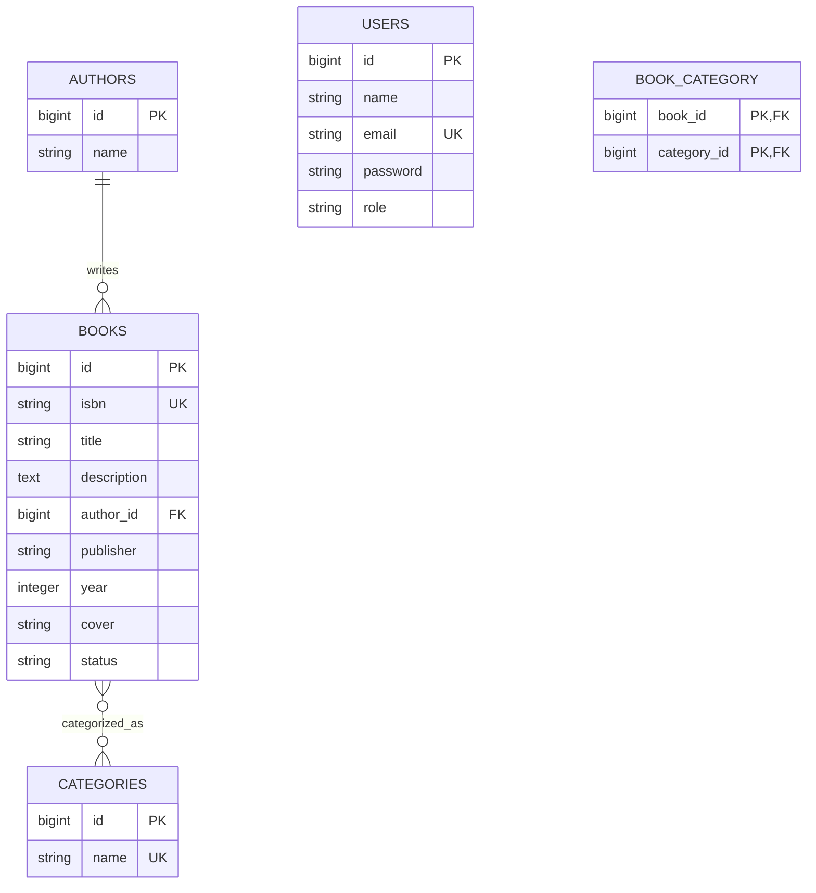

# Laporan Praktikum Tugas 6: Authbook

## Menjalankan aplikasi

Jalankan perintah berikut di PowerShell dari folder proyek. Proyek memerlukan PHP 8.3; gunakan PHP Laragon jika `php -v` menunjukkan versi yang lebih lama:

```powershell
Set-Location 'C:\laragon\www\prak-pbw\Tugas6\authbook'
$phpDir = 'C:\laragon\bin\php\php-8.3.33-Win32-vs16-x64'
$env:PATH = "$phpDir;$env:PATH"
& "$phpDir\php.exe" artisan migrate --seed
& "$phpDir\php.exe" artisan serve
```

Buka `http://localhost:8000/admin/login`. Perintah `migrate --seed` tidak menghapus tabel; hindari `migrate:fresh` bila ingin mempertahankan data lokal.

## 1. Arsitektur aplikasi

### Diagram ERD



### Relasi dan tabel

- Satu **author** dapat memiliki banyak **books**; setiap buku memiliki satu penulis (`books.author_id`).
- **Books** dan **categories** berelasi many-to-many melalui tabel pivot `book_category`. Satu buku dapat memiliki beberapa kategori, dan satu kategori dapat dipakai beberapa buku.
- Tabel **users** menyimpan akun login beserta role `admin`, `staff`, atau `viewer`. Password disimpan sebagai hash oleh cast model Laravel.
- Tabel `books` menyimpan deskripsi, metadata, status ketersediaan, dan lokasi cover buku.

### Alur request

1. Browser meminta halaman `/admin` atau salah satu halaman resource.
2. Laravel mencocokkan URL dengan route Filament dan menerapkan middleware session, autentikasi, serta CSRF.
3. Jika belum login, browser diarahkan ke `/admin/login`. Setelah login, Filament memanggil `User::canAccessPanel()`.
4. Halaman resource Filament memvalidasi form, memanggil model Eloquent, dan menerapkan policy sebelum operasi yang dilindungi dijalankan.
5. Eloquent membaca atau menulis database SQLite melalui model dan relasinya.
6. Filament merender hasil sebagai halaman HTML; dashboard mengambil jumlah buku, penulis, serta buku yang tersedia dan dipinjam.

## 2. Filament dibandingkan CRUD manual

| Aspek | Filament | CRUD manual |
|---|---|---|
| Kecepatan awal | Resource menyediakan form, tabel, pencarian, filter, dan aksi CRUD dengan cepat. | Perlu membuat route, controller, validasi, view, dan aksi CRUD sendiri. |
| Konsistensi UI | Komponen admin dan pola interaksinya sudah tersedia. | Tampilan dan pola interaksi dapat disesuaikan penuh, tetapi harus dirawat sendiri. |
| Kontrol detail | Dapat dikustomisasi melalui schema, action, widget, dan policy. | Kontrol penuh sampai ke detail implementasi. |
| Biaya/perawatan | Bergantung pada kompatibilitas dan pembaruan Filament; cocok untuk panel admin. | Lebih banyak kode dan pengujian, namun tidak bergantung pada UI admin Filament. |

Filament cocok untuk dashboard internal, panel administrasi, dan aplikasi yang perlu CRUD dengan cepat. CRUD manual lebih cocok untuk alur publik atau pengalaman pengguna yang sangat khusus, ketika struktur Filament tidak sesuai, atau ketika dependensi UI admin tambahan tidak diinginkan.

## 3. Refleksi pembelajaran

Contoh refleksi yang dapat disesuaikan dengan pengalaman praktikum:

- **Yang dipelajari:** pemodelan relasi Eloquent, migration dan seeder, pembuatan resource Filament, pembatasan akses menggunakan policy, serta penggunaan widget untuk ringkasan data.
- **Kesulitan dan solusi:** environment terminal awal menggunakan PHP 8.2, sementara proyek membutuhkan PHP 8.3. Perintah Artisan dijalankan dengan PHP 8.3 dari Laragon. Izin juga perlu diterapkan pada policy, bukan hanya menyembunyikan tombol di UI.
- **Rencana pengembangan:** menambahkan validasi ISBN yang lebih ketat, proses peminjaman/pengembalian, riwayat transaksi, serta pengujian alur CRUD dan login berbasis browser.

> Bagian refleksi di atas adalah draf; ganti atau lengkapi dengan pengalaman pribadi sebelum dikumpulkan.

## Akun demo lokal

Seeder menyediakan akun berikut; seluruh akun demo seeder menggunakan password `password`:

| Role | Email |
|---|---|
| Admin | `admin@example.com` |
| Staff | `staff@example.com` |
| Viewer | `viewer@example.com` |

Seeder mempertahankan akun lokal `admin@gmail.com` yang telah dibuat sebelumnya dan menetapkan role-nya sebagai admin tanpa mengganti password.

## Bukti tampilan

- [Admin berhasil login dan melihat dashboard](./screenshots/admin-dashboard.png)
- [Daftar buku hasil seeder](./screenshots/books-list.png)
- [Form tambah buku](./screenshots/create-book-form.png)
- [Hasil pencarian buku](./screenshots/book-search.png)
- [Filter status buku aktif](./screenshots/book-filter.png)
